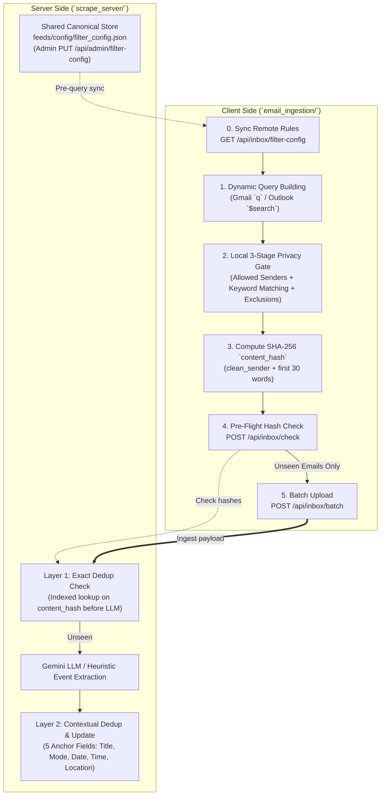

# Keyword & Filter Fields Update Summary (`email_ingestion` & `scrape_server`)

This document summarizes the architectural and code updates applied across `email_ingestion/` (client-side) and `scrape_server/` (server-side). It explains **what was changed**, **why each change was necessary**, and how the modules work together seamlessly.

---

## 1. Executive Summary & Flow Architecture

---

## 2. Detailed Breakdown of Changes & Why

### A. Dynamic Remote Config Sync (`filter_config.json`)
* **What was changed**:
  * **Server**: Added `scrape_server/feeds/config/filter_config.json`, public read endpoint `GET /api/inbox/filter-config?client_version=N` in `server.py`, and token-protected `PUT /api/admin/filter-config` in `admin.py`.
  * **Client**: Added `sync_filter_config_from_server()` in `privacy_filter.py`, called at the very beginning of `run_pipeline()` in `run_ingestion.py`. Added user-override keys (`user_added_senders`, `user_added_keywords`, `user_excluded_keywords`) and `--no-config-sync` CLI flag.
* **Why**:
  * Previously, `filter_config.json` was static on user devices. If the team discovered a new faculty sender or event keyword, users had to manually download a new file.
  * Synchronizing **before** email queries ensures Gmail/Outlook native APIs download only relevant messages.
  * A hardcoded `BASELINE_EXCLUDED_KEYWORDS` floor guarantees student privacy cannot be compromised even if the server is misconfigured.

---

### B. Privacy & Data Minimization
* **What was changed**:
  * Added `STORE_EMAIL_CONTENT = False` in `scrape_server/config.py`.
  * Updated `EmailMessage.to_dict(include_content=False)` in `database/models.py`.
  * Added `POST /api/inbox/check` on the server and `filter_unseen_by_server()` on the client.
  * Added `rss_bot.db` and `feeds/inbox/` to `.gitignore`.
* **Why**:
  * The full email body is only required in-memory during event extraction. Storing raw emails in SQLite or writing them to `feeds/inbox/messages.json` caused private student communications to be committed to git or exposed over public feeds.
  * The pre-flight check allows the client to send *only hashes* first; bodies of emails already recorded on the server **never leave the user's laptop**.

---

### C. Dedicated `content_hash` Column & Layer 1 Deduplication
* **What was changed**:
  * Added a dedicated `content_hash: Mapped[Optional[str]]` (unique, indexed) column to `EmailMessage` in `database/models.py` with automatic SQLite migration in `database/db.py`.
  * In `extractor.py`, `ingest_email_message()` checks `content_hash` via an indexed DB query **before** invoking Gemini LLM.
  * In `email_ingestion/privacy_filter.py`, `compute_content_hash()` creates a deterministic SHA-256 fingerprint: `clean_sender + "|" + first 30 words of (subject + body)`.
* **Why**:
  * `message_id` was previously overloaded with two meanings (email header ID vs. deduplication hash).
  * Mass-broadcast announcements sent to thousands of students have identical senders and opening text, but trailing footers/signatures vary. Hashing the sender and first 30 words reliably detects identical announcements across users, skipping redundant and expensive LLM calls.

---

### D. Date Normalization & Resilient Parsing
* **What was changed**:
  * Client: Added `normalize_date_to_iso()` in `privacy_filter.py` to convert RFC 2822 dates to ISO 8601 (`YYYY-MM-DDTHH:MM:SS+07:00`).
  * Server: In `extractor.py`, `ingest_email_message()` accepts ISO 8601 and includes `email.utils.parsedate_to_datetime` as an automated fallback.
* **Why**:
  * Gmail API returns dates in RFC 2822 format (`Tue, 10 Nov 2026 20:28:00 +0700`). The server's `datetime.fromisoformat()` failed on this format and silently defaulted to "now", distorting relative date calculations ("this Saturday") in LLM prompts.

---

### E. Batch Ingestion Efficiency & Server Guardrails
* **What was changed**:
  * Added `sync_folders: bool = True` in `ingest_email_message()`. When called from `POST /api/inbox/batch`, `sync_folders=False` is used, and `sync_all_event_folders()` is executed **only once** at the end of the batch.
  * Added `guard_ingest` in `server.py` with rate limiting (`INGEST_RATE_LIMIT_PER_MINUTE = 60`), payload size caps (`INGEST_MAX_CONTENT_CHARS = 50000`), and optional `X-Ingest-Token` support.
* **Why**:
  * Uploading a batch of 20 emails previously triggered 20 separate rewrites of every JSON and XML feed file on disk, wasting I/O.
  * Rate-limiting and size caps protect the public server endpoint from denial-of-service and memory exhaustion.

---

## 3. File Modification Index

| Component | File | Key Purpose |
|---|---|---|
| **Client** | `email_ingestion/filter_config.json` | Stores local configuration, version tracking, and student customization overrides. |
| **Client** | `email_ingestion/privacy_filter.py` | 3-stage privacy gate, SHA-256 hashing, date normalization, and server config synchronization. |
| **Client** | `email_ingestion/run_ingestion.py` | CLI coordinator, pre-flight hash checker, and batch HTTP shipper. |
| **Server** | `scrape_server/config.py` | Data minimization toggles (`STORE_EMAIL_CONTENT`) and rate-limiting constants. |
| **Server** | `scrape_server/database/models.py` | Added `content_hash` column and excluded raw content from default serialization. |
| **Server** | `scrape_server/database/db.py` | Lightweight SQLite auto-migration and indexed hash lookup (`get_known_content_hashes`). |
| **Server** | `scrape_server/events/extractor.py` | Layer 1 exact dedup check before LLM, RFC 2822 date fallback, and single batch sync. |
| **Server** | `scrape_server/server.py` | Added `/api/inbox/filter-config`, `/api/inbox/check`, and rate-limiting dependency (`guard_ingest`). |
| **Server** | `scrape_server/admin.py` | Added live config update route `PUT /api/admin/filter-config`. |
| **Server** | `scrape_server/feeds/config/filter_config.json` | Canonical server-side filter configuration file. |
