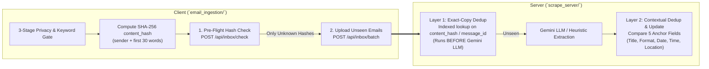

# Proposed Changes Summary for Teammate (`scrape_server` & `email_ingestion` Integration)

This document summarizes the architectural and code improvements applied across `scrape_server/` and `email_ingestion/` to protect student privacy, speed up batch ingestion, separate provenance IDs from content hashes, and harden the public ingest API.

---

## Overview of the 2-Layer Deduplication Pipeline

---

## 1. Privacy & Data Minimization (`#1` — Highest Priority)

### Problem
- Previously, `EmailMessage.to_dict()` included the raw `content` (full email body), which was written to `feeds/inbox/messages.json`, served publicly at `/feeds/inbox/messages.json`, broadcast to all connected WebSocket clients, and committed into git along with `rss_bot.db`.

### Changes Applied
- **[`scrape_server/config.py`](file:///Users/son/Documents/PythonAPI/scrape_server/config.py)**: Added `STORE_EMAIL_CONTENT = False` (default). The full email body is used in-memory during Gemini/heuristic event extraction, and is **not** persisted to SQLite afterwards unless explicitly enabled.
- **[`scrape_server/database/models.py`](file:///Users/son/Documents/PythonAPI/scrape_server/database/models.py)**: Updated [`EmailMessage.to_dict(include_content=False)`](file:///Users/son/Documents/PythonAPI/scrape_server/database/models.py#L244-L276) so public JSON feeds, `/api/inbox`, and WebSocket payloads only expose metadata (`id`, `message_id`, `content_hash`, `client_id`, `subject`, `sender`, `received_at`, `status`, `changes`, and extracted `event`).
- **[`scrape_server/.gitignore`](file:///Users/son/Documents/PythonAPI/scrape_server/.gitignore)**: Added `rss_bot.db` and `feeds/inbox/` so raw databases and client inbox logs are not accidentally committed to git.
- **Pre-Flight Hash Check (`POST /api/inbox/check`)**: Added in [`scrape_server/server.py`](file:///Users/son/Documents/PythonAPI/scrape_server/server.py#L377-L390) and called by [`filter_unseen_by_server`](file:///Users/son/Documents/PythonAPI/email_ingestion/run_ingestion.py#L45-L69) in `email_ingestion/run_ingestion.py`. Clients send just their list of `content_hash` strings first; if the server already has an email, its body never leaves the student's device.

---

## 2. Separate `content_hash` from `message_id` (`#2`)

### Problem
- `EmailMessage.message_id` was doing two jobs: storing the email provider's own `Message-ID` / UID **and** storing the client's cross-user deduplication hash.

### Changes Applied
- **[`scrape_server/database/models.py`](file:///Users/son/Documents/PythonAPI/scrape_server/database/models.py#L217-L221)**: Added a dedicated, unique, indexed column `content_hash: Mapped[Optional[str]]` on `EmailMessage` alongside `message_id`.
- **[`scrape_server/database/db.py`](file:///Users/son/Documents/PythonAPI/scrape_server/database/db.py#L20-L43)**: Added [`_apply_lightweight_migrations()`](file:///Users/son/Documents/PythonAPI/scrape_server/database/db.py#L20-L36) inside `init_db()` so existing `rss_bot.db` files automatically gain the `content_hash` column and unique index (`ix_email_messages_content_hash`) without manual SQL or data loss.
- **[`scrape_server/events/extractor.py`](file:///Users/son/Documents/PythonAPI/scrape_server/events/extractor.py#L848-L865)**: In `ingest_email_message()`, Layer 1 exact-copy deduplication now checks `content_hash` first (and falls back to `message_id`) **before** any Gemini LLM call.

---

## 3. Single Folder Sync per Batch (`#3`)

### Problem
- `ingest_email_message()` called `sync_all_event_folders(session)` after every single email. Uploading a batch of 20 emails caused 20 full rewrites of every JSON and XML file on disk.

### Changes Applied
- **[`scrape_server/events/extractor.py`](file:///Users/son/Documents/PythonAPI/scrape_server/events/extractor.py#L802-L804)**: Added `sync_folders: bool = True` parameter to `ingest_email_message()`.
- **[`scrape_server/server.py`](file:///Users/son/Documents/PythonAPI/scrape_server/server.py#L425-L471)**: `POST /api/inbox/batch` now passes `sync_folders=False` for each item in the loop and calls `sync_all_event_folders()` **once** at the end of the batch if any row was created, updated, or recorded.

---

## 4. Ingest Authentication, Rate Limiting & Date Parsing (`#4` & `#5`)

### Problem
- `/api/inbox` and `/api/inbox/batch` had no rate limit, payload size limit, or optional API key guard.
- Gmail's `Date` header is RFC 2822 (`Tue, 10 Nov 2026 20:28:00 +0700`), which failed `datetime.fromisoformat()` and silently defaulted to the server's current clock time—skewing relative date resolution ("this Saturday") in the Gemini prompt.

### Changes Applied
- **[`guard_ingest` Dependency (`scrape_server/server.py`)](file:///Users/son/Documents/PythonAPI/scrape_server/server.py#L75-L93)**:
  - Enforces a per-IP sliding-window rate limit (`INGEST_RATE_LIMIT_PER_MINUTE = 60`), batch size cap (`INGEST_MAX_BATCH_SIZE = 50`), and body length cap (`INGEST_MAX_CONTENT_CHARS = 50000`).
  - If the server administrator sets the environment variable `INGEST_API_KEY`, requests must include a matching `X-Ingest-Token` header (compared in constant time via `hmac.compare_digest`). When `INGEST_API_KEY` is unset, the endpoints remain open for frictionless local/demo testing.
- **Lenient Date Parsing (Both Sides)**:
  - Client ([`normalize_date_to_iso`](file:///Users/son/Documents/PythonAPI/email_ingestion/privacy_filter.py#L129-L143)) converts RFC 2822 email dates to ISO 8601 before sending.
  - Server ([`ingest_email_message`](file:///Users/son/Documents/PythonAPI/scrape_server/events/extractor.py#L829-L842)) now accepts both ISO 8601 and RFC 2822 (`email.utils.parsedate_to_datetime`) as a fallback.

