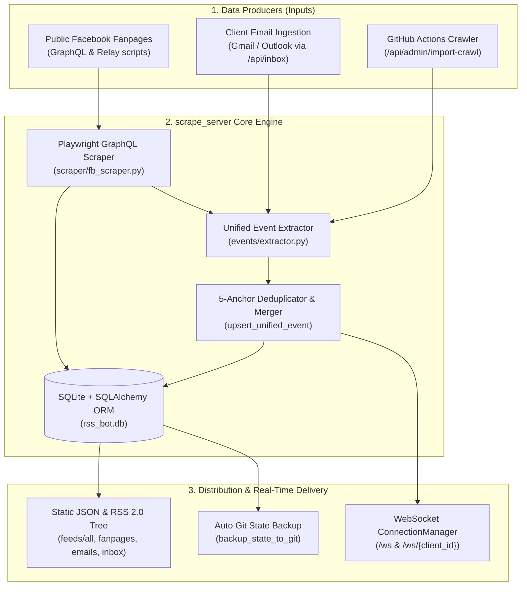
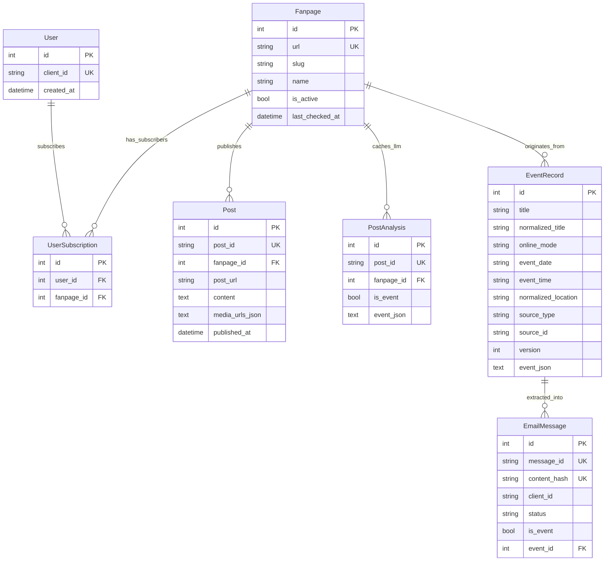

# `scrape_server` — Complete Architecture, Flows & Design Decisions

This document explains every subsystem and flow inside `scrape_server/`, the **design options** that existed for each problem, **why the current solution was chosen**, how it works line-by-line, and a glossary of technical terms.

---

## 1. High-Level System Architecture

---

## 2. Subsystem Breakdown: Problem, Design Options & Why We Chose Our Solution

### Flow 1: Public Facebook Fanpage Scraping ([`scraper/fb_scraper.py`](file:///Users/son/Documents/PythonAPI/scrape_server/scraper/fb_scraper.py))

#### Problem Statement
Facebook does not offer an open public API for reading arbitrary university/club fanpage posts without pagina-owner Business verification. Moreover, modern Facebook ("Comet" UI) obfuscates HTML class names (e.g. `x1lliihq x6ikm8r`), lazy-loads posts on scroll, pops up login walls, and mixes visitor comments or shared posts with the fanpage's own timeline posts.

#### Design Options Considered
| Option | How It Works | Pros | Cons / Why Rejected |
| :--- | :--- | :--- | :--- |
| **A. Official Facebook Graph API** | Call `graph.facebook.com/{page_id}/posts` with an access token. | Clean JSON, low CPU. | Requires App Review, Business Verification, and Page Admin permissions for every tracked club/faculty page — impossible for students tracking dozens of pages. |
| **B. HTTP `requests` + BeautifulSoup (Static HTML)** | Download page HTML via `curl`/`requests` and parse DOM tags. | Fast, lightweight, no browser needed. | Facebook renders an empty React shell to non-JS clients or immediately redirects to `/login`. |
| **C. Playwright DOM CSS/XPath Scraping** | Launch headless browser and query CSS selectors (`div[role="article"]`). | Renders JS properly. | Facebook randomizes CSS classes weekly, truncates long posts behind "See more" buttons in the DOM, and mixes comment images with post images. |
| **D. Playwright Network GraphQL + Embedded Relay JSON Interception (CHOSEN)** | Use Playwright to load the page and scroll, but **intercept raw `/api/graphql` network responses and `<script type="application/json">` Relay payloads** instead of reading visual DOM text. | Receives the full untruncated post text, exact Unix `creation_time`, canonical `post_id`, actor ownership metadata, and high-res image URIs regardless of CSS class changes. | Requires a recursive JSON walker (`_walk_graphql_for_posts`) that understands Facebook's Comet `Story` structure. |

#### Why We Chose Option D (+ DOM Fallback for Single Posts)
When Facebook's React frontend renders a timeline, the backend sends structured **GraphQL / Relay JSON** containing `comet_sections` (`Story` units). Even when the visual DOM hides text behind a "See more" button, the underlying JSON payload already contains the complete `message.text`.
- **How it works**:
  1. [`scrape_fanpage`](file:///Users/son/Documents/PythonAPI/scrape_server/scraper/fb_scraper.py#L486-L571) launches headless Chromium with `--disable-blink-features=AutomationControlled` to reduce bot fingerprinting.
  2. Attaches `page.on("response", handle_response)` to capture every HTTP 200 response from `/api/graphql` (which Facebook sends as newline-delimited JSON / NDJSON).
  3. Dismisses unauthenticated login modals via [`_dismiss_login_popup`](file:///Users/son/Documents/PythonAPI/scrape_server/scraper/fb_scraper.py#L449-L484) (pressing `Escape`, clicking `aria-label="Close"`, and removing `div[role="dialog"]` from the DOM).
  4. Extracts initial `<script type="application/json">` blocks embedded in the first HTML response, then scrolls `SCROLL_COUNT` (4) times to trigger lazy GraphQL fetches.
  5. [`_walk_graphql_for_posts`](file:///Users/son/Documents/PythonAPI/scrape_server/scraper/fb_scraper.py#L421-L447) traverses the JSON tree while deliberately skipping `SKIP_JSON_KEYS` (`comments`, `feedback`, `sideFeed`, `suggested_pages`) so comment text/images are never mistaken for posts.
  6. [`_extract_comet_story_unit`](file:///Users/son/Documents/PythonAPI/scrape_server/scraper/fb_scraper.py#L286-L419) verifies authorship via [`_belongs_to_fanpage`](file:///Users/son/Documents/PythonAPI/scrape_server/scraper/fb_scraper.py#L210-L238) and merges the outer caption with any shared post (`attached_story`).
  7. For single-post URLs ([`scrape_single_post`](file:///Users/son/Documents/PythonAPI/scrape_server/scraper/fb_scraper.py#L649-L810)), it also collects OpenGraph `<meta property="og:description">` and `div[role="article"]` as a DOM fallback in case Facebook serves a static single-post view without `comet_sections`.

---

### Flow 2: Multi-Tier Event Extraction Pipeline ([`events/extractor.py`](file:///Users/son/Documents/PythonAPI/scrape_server/events/extractor.py))

#### Problem Statement
Club fanpages and school emails contain noisy, unstructured Vietnamese/English text (holiday wishes, memes, recaps, administrative notices, and actual events). Calling an LLM on every single post wastes API quota and money; relying *only* on an LLM fails when quota is exhausted or when the LLM misses specific formatting conventions (e.g., QR codes inside event posters, or Vietnamese time ranges like `16h00 - 20h30`).

#### Design Options Considered
| Option | Pros | Cons / Why Rejected |
| :--- | :--- | :--- |
| **A. Pure Regex / Rule-Based Extraction** | Free, zero latency, deterministic, works offline. | Cannot write a clean 2-3 sentence summary (`description`), struggles with nuanced context (e.g., distinguishing a post-event "recap/thank-you" from an upcoming event). |
| **B. Pure LLM on Every Post** | High semantic accuracy on natural language. | Burns free-tier Gemini quota rapidly on memes/holiday posts, fails completely when rate-limited (HTTP 429) or in local dev without an API key, and cannot read QR codes inside image URLs without expensive multimodal token costs. |
| **C. 4-Stage Hybrid Pipeline: Keyword Pre-filter -> Gemini LLM (with Multi-Model Fallback) -> Regex Enrichment / Heuristic Fallback -> OpenCV QR Scanner (CHOSEN)** | Saves ~70% of LLM calls, survives 429 rate limits by switching models or falling back to regex, guarantees strict ISO-8601 timestamps, and decodes registration links from poster QR codes locally for free. | Slightly more code in `extractor.py`. |

#### Why We Chose Option C & How Each Stage Works
1. **Stage 1 — Accent-Insensitive Keyword Gate ([`looks_event_related`](file:///Users/son/Documents/PythonAPI/scrape_server/events/extractor.py#L139-L165))**:
   - Strips Vietnamese diacritics via Unicode NFD normalization ([`_strip_accents`](file:///Users/son/Documents/PythonAPI/scrape_server/events/extractor.py#L116-L118)).
   - Checks against `STRONG_EVENT_SIGNAL_RE` (`workshop`, `hoi thao`, `cuoc thi`, `tuyen quan`, etc.) or requires `>= 2` distinct `EVENT_KEYWORDS` (or `1` keyword + a date/time/URL).
   - Non-matching posts are immediately cached in `post_analyses` with `{"reason": "prefilter"}` and **zero LLM calls**.
2. **Stage 2 — Gemini REST Client with Model Cascade & Exponential Backoff ([`call_gemini_text`](file:///Users/son/Documents/PythonAPI/scrape_server/events/extractor.py#L210-L275))**:
   - Uses `responseMimeType: "application/json"` and `temperature: 0` for deterministic structured output.
   - If the primary model (`gemini-2.5-flash`) returns HTTP 429 (quota exhausted) or 503 after retries (`_retry_delay_seconds`), it automatically cascades through `FALLBACK_GEMINI_MODELS` (`gemini-2.5-flash-lite` -> `gemini-2.0-flash` -> `gemini-flash-latest`) and caches `_WORKING_GEMINI_MODEL`.
3. **Stage 3 — Post-LLM Regex Enrichment & Heuristic Fallback ([`_enrich_extracted_event_fields`](file:///Users/son/Documents/PythonAPI/scrape_server/events/extractor.py#L603-L683) & [`heuristic_extract_event`](file:///Users/son/Documents/PythonAPI/scrape_server/events/extractor.py#L685-L788))**:
   - Even when Gemini succeeds, `_enrich_extracted_event_fields` post-processes the JSON: strips `[THÔNG BÁO]` and `v/v` prefixes from `title` ([`_clean_event_title`](file:///Users/son/Documents/PythonAPI/scrape_server/events/extractor.py#L524-L539)), fills any missed `location` (`_extract_location_from_text`), `fee` (`_extract_fee_from_text`), or date/time range (`_extract_datetime_range_from_text`), and normalizes timestamps to ISO-8601 `+07:00` (defaulting start time to `00:00:00+07:00` and end time to `23:59:00+07:00`).
   - If `GEMINI_API_KEY` is missing or all Gemini models fail, `heuristic_extract_event` extracts the entire event structure purely via regex and sentence scoring (`_summarize_event_description`).
4. **Stage 4 — Local OpenCV Poster QR Code Decoder ([`scan_qr_link`](file:///Users/son/Documents/PythonAPI/scrape_server/events/extractor.py#L943-L968) & [`fill_registration_from_media`](file:///Users/son/Documents/PythonAPI/scrape_server/events/extractor.py#L970-L988))**:
   - University clubs frequently put the registration Google Form link *only* as a QR code inside the poster image.
   - If `registration_url` is not found in the text, the server downloads the first poster image into memory, decodes it with `cv2.QRCodeDetector` (trying original, 2x bicubic upscaled for small images, and grayscale), and sets `registration_status = "qr"`. If no text link and no QR exist, it marks `registration_url = "free"`.

---

### Flow 3: Cross-Source Event Deduplication & Live Update Engine ([`upsert_unified_event`](file:///Users/son/Documents/PythonAPI/scrape_server/events/extractor.py#L1067-L1255))

#### Problem Statement
The **same real-world university event** is often announced multiple times across different channels:
- Shared by 3 different faculty/club Facebook fanpages.
- Sent via email to students (`source_type="email"`).
- Posted first as a teaser ("Save the date"), then followed up with a room change ("Moved to Hall I") or a registration deadline extension.

If we only deduplicated by `post_id` or `message_id`, the user would see 4 duplicate cards for the same event, or outdated venue/deadline info.

#### Design Options Considered
| Option | Pros | Cons / Why Rejected |
| :--- | :--- | :--- |
| **A. Deduplicate Only by Primary Key (`post_id` / `message_id`)** | Trivial DB `UNIQUE` constraint. | Creates duplicate event records whenever two fanpages share the same event or an email repeats a Facebook announcement. |
| **B. Hash Entire Extracted JSON** | Exact match is easy. | Any minor wording difference in `description` or a changed venue produces a completely different hash, failing to link updates to the existing event. |
| **C. 5-Anchor Identity + Fuzzy Title Matching + Field-Level Diffing & Versioning (CHOSEN)** | Recognizes the same event across Facebook and Email, merges newly discovered fields, tracks `version` increments, and records an audit trail (`update_history` & `sources`). | Requires careful normalization of titles and locations. |

#### Why We Chose Option C & How It Works
1. **Anchor Extraction ([`extract_anchor_fields`](file:///Users/son/Documents/PythonAPI/scrape_server/events/extractor.py#L848-L883))**:
   Extracts 5 core identity/logistics fields:
   - `normalized_title`: Cleaned of brackets/lead-ins, accents stripped, lowercase alphanumeric.
   - `online_mode`: `"online"`, `"offline"`, or `"hybrid"`.
   - `date`: Canonical `YYYY-MM-DD`.
   - `time`: Canonical `HH:MM`.
   - `normalized_location`: Stripped of prefixes like `"Địa điểm:"`, lowercase alphanumeric.
2. **Matching & Comparison ([`compare_anchor_fields`](file:///Users/son/Documents/PythonAPI/scrape_server/events/extractor.py#L886-L940))**:
   - First looks up an exact `EventRecord.normalized_title` match in SQLite.
   - If none, runs `difflib.SequenceMatcher` across the 300 most recent events and matches if similarity `>= 0.85` (handles slight title variations like `"Workshop AI 2026"` vs `"Chuong trinh Workshop AI 2026"`).
   - Once matched by title, compares the remaining 4 anchor fields (`format`, `date`, `time`, `location`):
     - If any changed -> returns `"updated"` along with a `changes` diff dictionary `{"location": {"old": ..., "new": ...}}`.
     - If all match -> returns `"duplicate"`.
3. **Smart Backfilling & Explicit Registration Rules ([`_merge_registration_and_null_fields`](file:///Users/son/Documents/PythonAPI/scrape_server/events/extractor.py#L1026-L1064))**:
   - Even when an event is a `"duplicate"` on its 4 anchor fields, a later post/email might reveal the `fee`, `registration_url`, or an extended `reg_end_datetime` ("Gia hạn đăng ký").
   - `_merge_registration_and_null_fields` backfills any previously `null` fields and updates registration dates *only* if the new post explicitly stated them (`_reg_start_explicit` / `_reg_end_explicit`), bumping `EventRecord.version` and appending to `update_history` and `sources`.

---

### Flow 4: Hybrid Execution Architecture — Local VM vs. GitHub Actions Crawler ([`server.py`](file:///Users/son/Documents/PythonAPI/scrape_server/server.py#L193-L229) & [`.github/workflows/live_server_demo.yml`](file:///Users/son/Documents/PythonAPI/scrape_server/.github/workflows/live_server_demo.yml))

#### Problem Statement
Running headless Chromium (`Playwright`) requires ~500MB–1GB of RAM and significant CPU. Some hosting environments (low-RAM VMs) struggle with browser spikes or get rate-limited by Facebook's IP blocks, while other times the developer runs the server on a powerful local machine/VM with an Ngrok tunnel. Furthermore, if the VM restarts or is re-provisioned, local SQLite state could be lost.

#### Design Options Considered
| Option | Pros | Cons / Why Rejected |
| :--- | :--- | :--- |
| **A. Scrape Only on the Web Server VM** | Simple single-process architecture. | High RAM usage on the web host; if the VM dies, database state is lost unless backed up. |
| **B. Scrape Only in GitHub Actions (Static Repo)** | Free CI compute (7GB RAM Ubuntu runners), fresh datacenter IPs every run. | Cannot receive real-time client emails (`POST /api/inbox`) or serve live WebSockets 24/7 by itself. |
| **C. Dual-Mode Unified Scrape + Bidirectional Git Sync (CHOSEN)** | Supports both 24/7 VM local scraping (with automatic Git backup) AND offloading heavy Playwright crawls to GitHub Actions runners that push results to the live server via `/api/admin/import-crawl`. | Requires coordination between `scheduler.py`, `admin.py`, and GitHub Actions. |

#### Why We Chose Option C & How It Works
- **Mode 1: Local VM Scraping (`SERVER_AUTO_SCRAPE=True`, default)**:
  - `APScheduler` runs inside FastAPI's [`lifespan`](file:///Users/son/Documents/PythonAPI/scrape_server/server.py#L232-L259) on a daily cron (`08:00, 14:00, 20:00 ICT`) or fixed interval.
  - After each cycle, [`backup_state_to_git`](file:///Users/son/Documents/PythonAPI/scrape_server/scheduler.py#L46-L110) acquires a thread lock (`_GIT_BACKUP_LOCK`) and commits/rebases/pushes `rss_bot.db` and `feeds/` with `[skip ci]` to GitHub so state is durably backed up.
- **Mode 2: External GitHub Actions Offload (`--no-scrape` or `USE_GITHUB_ACTIONS_CRAWLER=true`)**:
  - Calling [`trigger_unified_scrape`](file:///Users/son/Documents/PythonAPI/scrape_server/server.py#L193-L229) dispatches `live_server_demo.yml` via GitHub's `workflow_dispatch` API ([`_trigger_github_actions_crawl`](file:///Users/son/Documents/PythonAPI/scrape_server/admin.py#L267-L298)).
  - The GitHub Actions runner fetches the active fanpage list from `GET /api/fanpages`, runs Playwright + Chromium inside CI, pushes scraped posts back to the live server via `POST /api/admin/import-crawl` ([`admin_import_crawl`](file:///Users/son/Documents/PythonAPI/scrape_server/admin.py#L186-L256)), pulls the updated `feeds/` tree, and commits to Git.

---

### Flow 5: Privacy-Preserving Email Ingestion, Pre-Flight Dedup & Remote Config Sync ([`server.py`](file:///Users/son/Documents/PythonAPI/scrape_server/server.py#L416-L539))

#### Problem Statement
1. **Config Drift**: `filter_config.json` lives on each student's machine (`email_ingestion/`). If we add new school sender domains or ĐRL keywords, updating every client manually is impossible.
2. **Duplicate Network & LLM Cost**: A student's client runs periodically and finds the same 15 emails. Re-uploading full email bodies and re-running Gemini every time wastes bandwidth and LLM quota.
3. **Privacy on the Server**: Even after client-side filtering, storing raw student email bodies in `rss_bot.db` (which gets backed up to Git!) is a privacy liability.

#### Design Options Considered & Why We Chose Our Solution
1. **Versioned Remote Config Pull (`GET /api/inbox/filter-config` & `PUT /api/admin/filter-config`)**:
   - *Why*: Polling a lightweight HTTP endpoint on client startup is much simpler than maintaining a persistent push channel to offline CLI scripts.
   - *How*: Client passes `?client_version=N`. If `server_version == client_version`, server returns `{"up_to_date": True, "version": N}` (~40 bytes). When an admin updates rules via `PUT /api/admin/filter-config` ([`admin_update_filter_config`](file:///Users/son/Documents/PythonAPI/scrape_server/admin.py#L589-L624)), the server auto-increments `version` in `feeds/config/filter_config.json`.
2. **Two-Phase Content-Hash Deduplication (`POST /api/inbox/check` -> `POST /api/inbox/batch`)**:
   - *Why*: Checking SHA-256 hashes before uploading bodies saves ~95% of upload bandwidth on repeat runs, and indexing `content_hash` separately from `message_id` prevents cross-provider duplicates (e.g. the same school announcement forwarded from Outlook to Gmail has a different `message_id` but identical normalized `content_hash`).
   - *How*: [`api_check_inbox_hashes`](file:///Users/son/Documents/PythonAPI/scrape_server/server.py#L435-L449) queries [`get_known_content_hashes`](file:///Users/son/Documents/PythonAPI/scrape_server/database/db.py#L393-L403) and returns `known` vs `unknown`. Then [`ingest_email_message`](file:///Users/son/Documents/PythonAPI/scrape_server/events/extractor.py#L1487-L1516) enforces a second DB-level guard on both `content_hash` and `message_id` before touching Gemini.
3. **Zero Raw-Body Persistence (`STORE_EMAIL_CONTENT = False` in [`config.py`](file:///Users/son/Documents/PythonAPI/scrape_server/config.py#L45))**:
   - *Why*: Once Gemini/heuristic extracts the structured event JSON (`title`, `date`, `location`, `registration_url`), the raw email body is no longer needed. Setting `STORE_EMAIL_CONTENT = False` stores `content=""` in `email_messages` while keeping `content_hash` and the extracted `analysis_json`, so `rss_bot.db` and `feeds/inbox/messages.json` never leak raw email text.

---

### Flow 6: Dual Storage Layer — SQLite Relational DB + Pre-Materialized Static Feed Tree ([`database/`](file:///Users/son/Documents/PythonAPI/scrape_server/database/db.py) & [`sync_all_event_folders`](file:///Users/son/Documents/PythonAPI/scrape_server/events/extractor.py#L1301-L1436))

#### Problem Statement
Downstream consumers have very different needs:
- The interactive web dashboard and API clients want filtered queries (`/api/events?source_type=email`, user subscriptions, deduplication lookups).
- Standard RSS readers (Feedly, Thunderbird, NetNewsWire) need static RSS 2.0 XML files (`/feeds/<slug>.xml`, `/users/<client_id>/rss.xml`).
- Lightweight frontend/mobile clients and GitHub Pages want zero-latency static JSON files organized by folder (`/feeds/all/events.json`, `/feeds/fanpages/<slug>/events.json`, `/feeds/emails/<client_id>/events.json`) that can be browsed like a filesystem (`/api/tree`).

#### Design Options Considered
| Option | Pros | Cons / Why Rejected |
| :--- | :--- | :--- |
| **A. Flat JSON Files Only (No DB)** | Easy to commit to Git. | Concurrent writes corrupt JSON files; relational queries (user M:N fanpage subscriptions, indexed hash lookups) become slow `O(N)` file scans. |
| **B. PostgreSQL / MySQL Only** | Strong concurrency. | Requires running and paying for an external database server; cannot be committed as a single portable file to GitHub Actions. |
| **C. SQLite (Source of Truth) + Materialized `feeds/` Folder Hierarchy (CHOSEN)** | SQLite (`rss_bot.db`) provides ACID transactions, foreign keys, and indexed lookups in a single portable file, while [`sync_all_event_folders`](file:///Users/son/Documents/PythonAPI/scrape_server/events/extractor.py#L1301-L1436) materializes ready-to-serve `.json` and `.xml` files onto disk after every write. | Slight disk duplication between `rss_bot.db` and `feeds/*.json` (negligible at campus scale). |

#### Database Schema (6 Tables in [`database/models.py`](file:///Users/son/Documents/PythonAPI/scrape_server/database/models.py))

---

### Flow 7: Real-Time WebSocket Multiplexing ([`ConnectionManager`](file:///Users/son/Documents/PythonAPI/scrape_server/server.py#L99-L148))

#### Problem Statement
When a background scrape or email ingestion finishes (which can take 10–60 seconds), connected browsers on the public dashboard (`/`) or user-specific feeds (`/ws/{client_id}`) need immediate live updates without hammering the server with HTTP polling every second.

#### Why WebSockets + Topic Bucketing (`__public__` vs `client_id`)
- [`ConnectionManager`](file:///Users/son/Documents/PythonAPI/scrape_server/server.py#L99-L148) maps `client_id -> Set[WebSocket]`.
- Visitors on the main dashboard connect to `/ws`, which registers them under the virtual key `"__public__"`.
- Personalized clients connect to `/ws/{client_id}`, which immediately sends an `"init"` event with their subscribed fanpages and tailored posts, and accepts bidirectional commands (`{"action": "subscribe", "urls": [...]}`, `{"action": "unsubscribe"}`, `{"action": "refresh"}`).
- When new posts arrive for a fanpage, [`on_new_posts_scraped`](file:///Users/son/Documents/PythonAPI/scrape_server/server.py#L131-L148) pushes to `"__public__"` AND looks up only the `client_id`s subscribed to that `fanpage_id` ([`get_subscribers_for_fanpage`](file:///Users/son/Documents/PythonAPI/scrape_server/database/db.py#L370-L380)), regenerates their `user_<client_id>.xml` RSS file, and pushes the WebSocket event exclusively to interested subscribers.

---

### Flow 8: Security, Rate Limiting & Fail-Closed Admin vs. Fail-Open Dev Ingest

| Security Mechanism | Location | Design & Why |
| :--- | :--- | :--- |
| **Admin Authentication (`require_admin`)** | [`admin.py`](file:///Users/son/Documents/PythonAPI/scrape_server/admin.py#L57-L63) | **Fail-Closed**: If `ADMIN_TOKEN` env var is unset, returns `HTTP 503` (Admin disabled). Uses constant-time `hmac.compare_digest` on `X-Admin-Token` header to prevent timing attacks. |
| **Ingest Guard & Rate Limiter (`guard_ingest`)** | [`server.py`](file:///Users/son/Documents/PythonAPI/scrape_server/server.py#L83-L97) | Checks `X-Ingest-Token` with `hmac.compare_digest` when `INGEST_API_KEY` is set (optional in local dev for frictionless testing), and enforces an in-memory **Sliding Window Rate Limiter** (`deque` of monotonic timestamps per IP, max `60 req/min`) plus payload size caps (`INGEST_MAX_BATCH_SIZE=50`, `INGEST_MAX_CONTENT_CHARS=50000`). |
| **Path Traversal Protection (`serve_feed_file`)** | [`server.py`](file:///Users/son/Documents/PythonAPI/scrape_server/server.py#L740-L770) | Resolves canonical paths via `FEEDS_DIR.resolve()` and `(FEEDS_DIR / file_path).resolve()` and verifies `base in target.parents` before serving, blocking `../../` directory traversal attacks with `HTTP 403`. |

---

## 3. Complete Endpoint & CLI Reference

### HTTP & WebSocket Endpoints ([`server.py`](file:///Users/son/Documents/PythonAPI/scrape_server/server.py) & [`admin.py`](file:///Users/son/Documents/PythonAPI/scrape_server/admin.py))
| Method & Path | Auth | Purpose |
| :--- | :--- | :--- |
| `GET /` | Public | Serves the interactive single-page HTML dashboard (directory tree explorer, unified events table, email inbox tester, single-post extractor, live WebSocket log). |
| `GET /api/tree` & `GET /feeds` | Public | Synchronizes and returns the categorized JSON/XML file hierarchy inside `feeds/`. |
| `GET /feeds/{file_path:path}` | Public | Serves static `.json` / `.xml` feed files or directory listings with path-traversal protection. |
| `GET /api/schedule` | Public | Returns active scheduler mode (`daily_cron`, `interval`, or `external_push`), ICT schedule hours, and `next_run_at`. |
| `GET /api/events` | Public | Queries unified `EventRecord` rows with optional `source_type`, `client_id`, `fanpage_id`, and `limit` filters. |
| `GET /api/fanpages` & `GET /api/posts` | Public | Lists tracked fanpages (with post counts) and recent scraped posts. |
| `POST /api/scrape` | Public | Triggers a unified scrape cycle (local VM background task or GitHub Actions dispatch). |
| `POST /api/extract-post` | Public | Scrapes a single Facebook post URL, extracts event data, and auto-adds the parent fanpage if `is_event=True`. |
| `GET /api/inbox` | Public | Lists processed `EmailMessage` records and their extraction outcomes (without raw bodies when `STORE_EMAIL_CONTENT=False`). |
| `GET /api/inbox/filter-config` | `guard_ingest` | Version-aware sync endpoint returning `feeds/config/filter_config.json` when `client_version != server_version`. |
| `POST /api/inbox/check` | `guard_ingest` | Pre-flight batch check of up to 500 SHA-256 `content_hash` strings; returns `known` vs `unknown`. |
| `POST /api/inbox` & `/api/events/ingest-email` | `guard_ingest` | Ingests a single client email through dedup -> Gemini/heuristic -> 5-anchor unification -> JSON sync. |
| `POST /api/inbox/batch` | `guard_ingest` | Batch-ingests up to 50 emails and runs `sync_all_event_folders` once at the end. |
| `GET/POST/DELETE /api/users/{client_id}/subscriptions` | Public | Manages per-user fanpage subscriptions and triggers scraping for newly added pages. |
| `GET /api/users/{client_id}/posts` & `/users/{client_id}/rss.xml` | Public | Returns JSON posts or RSS 2.0 XML tailored to `client_id`'s subscriptions. |
| `WS /ws` & `WS /ws/{client_id}` | Public | Real-time WebSocket streams for global dashboard updates and per-user subscription feeds. |
| `GET /admin` | Public HTML (API gated) | Serves the Admin UI (requires `X-Admin-Token` for all actions). |
| `GET /api/admin/verify` | `require_admin` | Validates `X-Admin-Token`. |
| `GET/POST/DELETE /api/admin/fanpages` | `require_admin` | Lists, adds (or extracts single post), and removes fanpages + purges their cached events/RSS. |
| `POST /api/admin/scrape` | `require_admin` | Triggers unified scrape. |
| `POST /api/admin/refetch-extract` | `require_admin` | Re-scrapes the `N` latest posts per fanpage and re-runs event extraction (`force_recheck`). |
| `POST /api/admin/import-crawl` | `require_admin` | Receives bulk scraped posts from GitHub Actions, saves to DB, runs extraction, and broadcasts via WebSocket. |
| `PUT /api/admin/filter-config` | `require_admin` | Updates `feeds/config/filter_config.json` live and increments `version`. |

### CLI Commands ([`main.py`](file:///Users/son/Documents/PythonAPI/scrape_server/main.py))
- `python main.py add <urls...> [--fetch]`: Normalize and add Facebook fanpage URLs to SQLite.
- `python main.py list`: Print rich table of tracked fanpages and post counts.
- `python main.py remove <id|slug|url>`: Delete fanpage and regenerate RSS feeds.
- `python main.py fetch [target]`: Run one immediate scrape + event extraction cycle.
- `python main.py start [urls...] [--hours 8,14,20] [--interval SEC]`: Run standalone CLI scheduler daemon.
- `python main.py posts [--page-id ID] [--limit N]`: Inspect scraped posts in terminal.
- `python main.py export-rss`: Rebuild all `.xml` files from SQLite without scraping.
- `python main.py extract [--limit N] [--recheck] [--page TARGET]`: Run event extractor on unanalyzed/remaining posts.
- `python main.py extract-post <post_url>`: Scrape & extract a single Facebook post URL from CLI.
- `python main.py serve [--host] [--port] [--hours] [--interval] [--no-scrape]`: Launch the FastAPI + WebSocket server.

